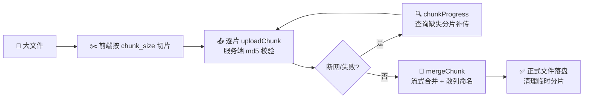

<div align="center">

# 📦 webman-storage

**webman 简单易用多文件上传插件**

本地 / 阿里云 OSS / 腾讯云 COS / 七牛云 / AWS S3 · 统一 API · 开箱即用

[](https://packagist.org/packages/tinywan/storage)
[](https://packagist.org/packages/tinywan/storage)
[](https://packagist.org/packages/tinywan/storage)
[](https://packagist.org/packages/tinywan/storage)
[](https://packagist.org/packages/tinywan/storage)
[](https://packagist.org/packages/tinywan/storage)
[]()
[]()

</div>

## ✨ 特性

- 🗃️ **多存储统一 API** —— 本地、阿里云 OSS、腾讯云 COS、七牛云、AWS S3 一键切换
- 📤 **多文件上传** —— 一次请求上传多个文件，返回结构化结果
- 🖼️ **Base64 上传** —— 前端截图 / Canvas 数据流直传云端
- 🗂️ **服务端文件上传** —— 服务端导出文件直接转存云端
- 🧩 **大文件分片上传** —— 前端切片、逐片校验、断点续传、自动合并（本地存储）
- 🔒 **上传验证** —— 大小、数量、后缀黑白名单全支持

### 能力矩阵

| 云端              | 多文件上传 | Base64 图片上传 | 服务器文件上传 | 大文件分片上传 |
| ----------------- | :--------: | :-------------: | :------------: | :------------: |
| 🍏 私有云（本地） |     ✅     |       —         |       ✅       |       ✅       |
| 🍓 阿里云          |     ✅     |       ✅        |       ✅       |       —        |
| 🍋 腾讯云          |     ✅     |       ✅        |       ✅       |       —        |
| 🍇 七牛云          |     ✅     |       ✅        |       ✅       |       —        |
| 🌰 亚马逊（S3）    |     ✅     |       ✅        |       ✅       |       —        |

---

## 🚀 安装

```bash
composer require tinywan/storage
```

> [!NOTE]
> 要求 `PHP >= 7.2`、`workerman/webman-framework ^1.5.4 || ^2.0`。
> 插件安装后自动发布配置到 `config/plugin/tinywan/storage/app.php`。

---

## ⚡ 快速开始

```php
$res = Tinywan\Storage\Storage::uploadFile();
var_dump(json_encode($res));
```

> [!NOTE]
> 无需手动初始化，默认使用配置 `storage.default` 指定的上传适配器。

### 上传成功信息

```json
[
    {
        "key": "webman",
        "origin_name": "常用编程软件和工具.xlsx",
        "save_name": "03414c9bdaf7a38148742c87b96b8167.xlsx",
        "save_path": "/var/www/webman-admin/runtime/storage/03414c9bdaf7a38148742c87b96b8167.xlsx",
        "url": "/storage/03414c9bdaf7a38148742c87b96b8167.xlsx",
        "unique_id": "03414c9bdaf7a38148742c87b96b8167",
        "size": 15050,
        "mime_type": "application/vnd.openxmlformats-officedocument.spreadsheetml.sheet",
        "extension": "xlsx"
    }
]
```

> [!WARNING]
> 上传失败时抛出 `StorageException` 异常。

### 成功响应字段

| 字段          | 描述              | 示例值                                                                        |
| ------------- | ----------------- | ----------------------------------------------------------------------------- |
| `key`         | 上传文件 key      | `webman`                                                                      |
| `origin_name` | 原始文件名        | `常用编程软件和工具.xlsx`                                                      |
| `save_name`   | 保存文件名        | `03414c9bdaf7a38148742c87b96b8167.xlsx`                                       |
| `save_path`   | 文件保存路径      | `/var/www/webman-admin/runtime/storage/03414c9bdaf7a38148742c87b96b8167.xlsx` |
| `url`         | url 访问路径      | `/storage/03414c9bdaf7a38148742c87b96b8167.xlsx`                              |
| `unique_id`   | 文件散列值        | `03414c9bdaf7a38148742c87b96b8167`                                            |
| `size`        | 文件大小（字节）  | `15050`                                                                       |
| `mime_type`   | 文件类型          | `application/vnd.openxmlformats-officedocument.spreadsheetml.sheet`           |
| `extension`   | 文件扩展名        | `xlsx`                                                                        |

---

## 📁 上传规则

默认上传到本地服务器，在 `runtime/storage` 目录下生成以当前日期为子目录、以文件流散列值（`algo` 配置，默认 `sha1`）为文件名的文件：

```text
runtime/storage/fd2d472da56c71a6da0a5251f5e1b586.png
```

如果希望上传的文件可以直接访问或下载，可以将上传根目录配置到 `public` 目录。在 `config/plugin/tinywan/storage/app.php` 中配置：

```php
'local' => [
    'adapter' => \Tinywan\Storage\Adapter\LocalAdapter::class,
    'root' => public_path() . '/storage',
],
```

浏览器访问：`http://127.0.0.1:8787/storage/fd2d472da56c71a6da0a5251f5e1b586.png`

---

## 🛡️ 上传验证

支持对上传文件的大小、数量、类型和后缀进行验证：

| 字段           | 描述                          | 示例值              |
| -------------- | ----------------------------- | ------------------- |
| `single_limit` | 单个文件的大小限制，默认 200M | `1024 * 1024 * 200` |
| `total_limit`  | 所有文件的大小限制，默认 200M | `1024 * 1024 * 200` |
| `nums`         | 文件数量限制，默认 10         | `10`                |
| `include`      | 被允许的文件类型列表（白名单）| `['xlsx', 'pdf']`   |
| `exclude`      | 不被允许的文件类型列表（黑名单）| `['png', 'jpg']`   |

---

## ☁️ 云端 SDK

按需安装对应云存储 SDK 后，仅需切换 `Storage::disk()` 参数即可：

| 云存储         | 安装命令                                        | 磁盘常量                  |
| -------------- | ----------------------------------------------- | ------------------------- |
| 🍓 阿里云 OSS   | `composer require aliyuncs/oss-sdk-php`         | `Storage::MODE_OSS`       |
| 🍋 腾讯云 COS   | `composer require qcloud/cos-sdk-v5`            | `Storage::MODE_COS`       |
| 🍇 七牛云       | `composer require qiniu/php-sdk`                | `Storage::MODE_QINIU`     |
| 🌰 亚马逊 S3    | `composer require league/flysystem-aws-s3-v3`   | `Storage::MODE_S3`        |

```php
// 示例：上传到阿里云 OSS
$res = \Tinywan\Storage\Storage::disk(\Tinywan\Storage\Storage::MODE_OSS)->uploadFile();
```

---

## 🖼️ 上传 Base64 图片

> **使用场景：** 前端直接截图（头像、Canvas 等）生成 Base64 数据流的图片，直接上传到云端。

### 请求参数

```json
{
    "extension": "png",
    "base64": "data:image/jpeg;base64,/9j/4AAQSkxxxxxxxxxxxxZJRgABvtyQBIr/MPTPTP/2Q=="
}
```

### 请求示例（阿里云）

```php
public function upload(Request $request)
{
    $base64 = $request->post('base64');
    $response = \Tinywan\Storage\Storage::disk(\Tinywan\Storage\Storage::MODE_OSS, false)->uploadBase64($base64, 'png');
    var_dump($response);
}
```

### 响应参数

```json
{
    "save_path": "storage/20220402213639624851671439e.png",
    "url": "http://webman.oss.tinywan.com/storage/20220402213639624851671439e.png",
    "unique_id": "20220402213639624851671439e",
    "size": 11802,
    "extension": "png"
}
```

---

## 🗂️ 上传服务端文件

> **使用场景：** 服务端导出的文件需要上传到云端存储，或者临时下载文件存储。

### 请求示例（阿里云）

```php
$serverFile = runtime_path() . DIRECTORY_SEPARATOR . 'storage/webman.png';
$res = \Tinywan\Storage\Storage::disk(\Tinywan\Storage\Storage::MODE_OSS, false)->uploadServerFile($serverFile);
```

### 响应参数

```json
{
    "origin_name": "/var/www/webman-admin/runtime/storage/webman.png",
    "save_path": "storage/6edf04d7c26f020cf5e46e6457620220402213414.png",
    "url": "http://webman.oss.tinywan.com/storage/6ed9ffd54d0df57620220402213414.png",
    "unique_id": "6edf04d7c26f020cf5e46e6403213414",
    "size": 3505604,
    "extension": "png"
}
```

---

## 🧩 大文件分片上传（本地）

> **使用场景：** 大文件（超出 `upload_max_filesize` 或网络不稳定）由前端切片后逐片上传，服务端校验并合并。目前仅本地适配器支持，云端适配器（OSS/COS/七牛/S3）后续版本支持。
>
> 🧪 端到端测试示例见 [`example/`](example/)：示例控制器、路由和 curl 一键测试脚本。

### 工作流程



### 相关配置

```php
'storage' => [
    'chunk_size' => 1024 * 1024 * 5, // 单个分片的大小限制，默认5M
    'local' => [
        // ...
        'chunk_path' => runtime_path() . '/storage/.chunks', // 分片临时存储目录，默认 {root}/.chunks
    ],
],
```

### ① 上传分片 `uploadChunk`

```php
public function uploadChunk(Request $request)
{
    $file = $request->file('file'); // 单个分片文件
    $fileId = $request->post('file_id'); // 文件唯一标识，由前端生成（字母数字开头，仅允许字母、数字、下划线、中划线，长度不超过64）
    $chunkIndex = (int) $request->post('chunk_index'); // 分片序号，从0开始
    $chunkMd5 = $request->post('chunk_md5'); // 当前分片的md5，服务端会校验

    return \Tinywan\Storage\Storage::disk(\Tinywan\Storage\Storage::MODE_LOCAL, false)
        ->uploadChunk($file, $fileId, $chunkIndex, $chunkMd5);
}
```

响应参数：

```json
{
    "file_id": "demo-file",
    "chunk_index": 0,
    "save_name": "00000000.part",
    "save_path": "/var/www/webman/runtime/storage/.chunks/demo-file/00000000.part",
    "size": 5242880,
    "md5": "d41d8cd98f00b204e9800998ecf8427e"
}
```

> [!NOTE]
> 同一 `chunk_index` 重复上传会覆盖旧分片（断点续传语义）；md5 校验失败会抛出 `StorageException` 且不落盘。

### ② 断点续传查询 `chunkProgress`

```php
$progress = \Tinywan\Storage\Storage::disk(\Tinywan\Storage\Storage::MODE_LOCAL, false)
    ->chunkProgress($fileId, $totalChunks);
```

响应参数（前端根据 `missing` 补传缺失分片）：

```json
{
    "file_id": "demo-file",
    "total": 4,
    "uploaded": [0, 2],
    "missing": [1, 3],
    "finished": false
}
```

### ③ 合并分片 `mergeChunk`

```php
$result = \Tinywan\Storage\Storage::disk(\Tinywan\Storage\Storage::MODE_LOCAL, false)
    ->mergeChunk($fileId, $totalChunks, 'video.mp4'); // 文件名仅用于提取扩展名并做 include/exclude 校验
```

响应参数与普通上传单文件结构一致（`origin_name/save_name/save_path/url/unique_id/size/mime_type/extension`），最终文件名为 `文件散列值.扩展名`，合并成功后自动清理分片临时目录。

> [!WARNING]
> 1. 分片上传必须使用 `Storage::disk(MODE_LOCAL, false)` 方式调用（跳过 HTTP 文件上传校验）
> 2. 合并过程有独占锁，重复触发会提示"文件正在合并中"
> 3. 中断未合并的分片临时目录（`chunk_path` 下）暂不自动清理，请由业务侧定期清理

---

## 🧪 代码质量

工具链：[Mago](https://github.com/carthage-software/mago)（格式化 / lint / 静态分析）+ [Pest](https://pestphp.com)（单元测试）

```bash
composer check        # 格式检查 + lint + 静态分析 + 测试
composer format       # 代码格式化（mago format）
composer lint         # 代码规范检查（mago lint）
composer analyse      # 静态分析（mago analyze）
composer test         # 单元测试（pest）
```

---

<div align="center">

**如果这个项目对你有帮助，欢迎 ⭐ Star 支持一下！**

Made with ❤️ by [Tinywan](https://github.com/Tinywan) · [MIT License](https://packagist.org/packages/tinywan/storage)

</div>
